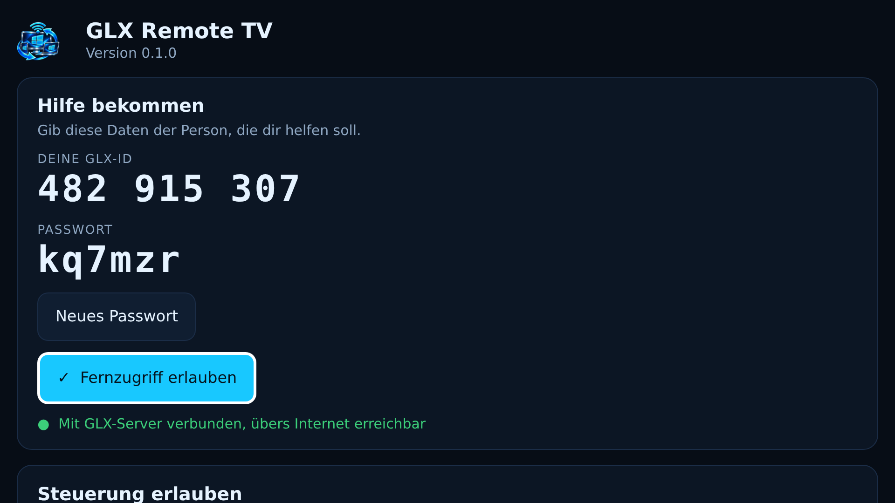
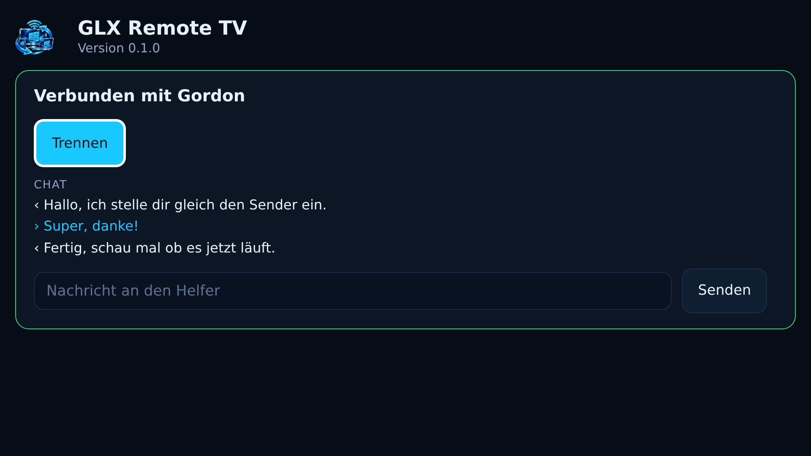
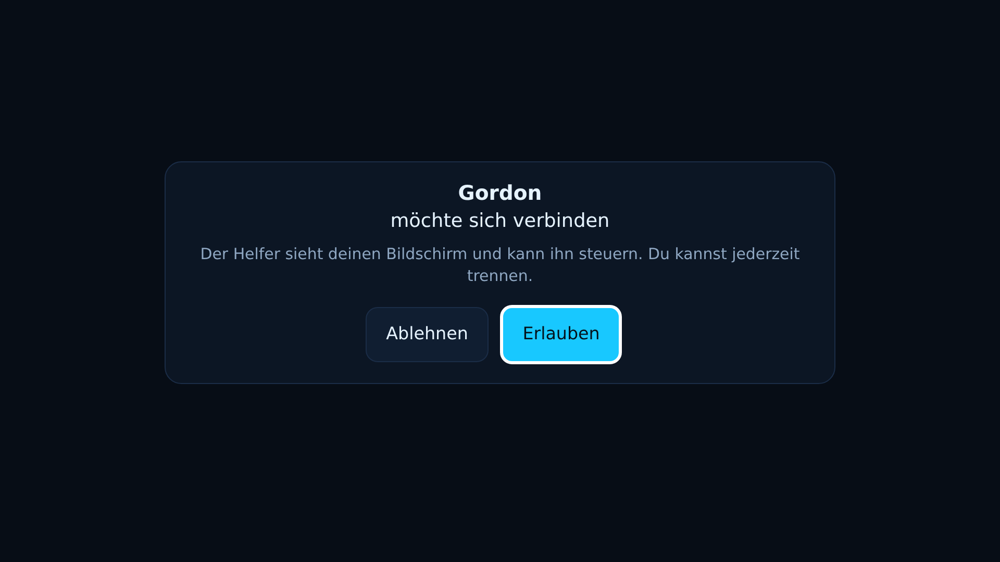

🌍 Sprachen: [🇺🇸 English](README.md) | [🇩🇪 Deutsch](README.de.md)

# 💠 GLX Remote Android TV

### Fernhilfe für den Fernseher.

*Ein Helfer am PC sieht das Bild deines Android-TV-Geräts und bedient es mit einer Fernbedienung auf dem Bildschirm.* ⚡

   

---

## ⬇️ Download

👉 Neueste Version: [Releases](../../releases/latest)  
👉 Shop und Lizenzen: [glx-tools.de](https://glx-tools.de/product/glx-remote-android-tv/)

---

## 📸 Überblick & Screenshots

### 1️⃣ Startbildschirm mit GLX-ID und Passwort

### 2️⃣ Sitzung mit Chat

### 3️⃣ Verbindungsanfrage

---

## ✨ Funktionen

- 🚀 **Hilfe am Fernseher aus der Ferne:** Der Helfer sieht das TV-Bild am PC und behebt Probleme mit Apps, Einstellungen oder Senderlisten, ohne vorbeizufahren.
- 🧩 **Fernbedienung wie deine echte:** Die Bildschirm-Fernbedienung passt zu deinem Gerät (z. B. Homatics, Philips Ambilight) mit Steuerkreuz, OK, Zurück, Home, Lautstärke und Wiedergabe.
- ⚙️ **Tasten für Streaming-Apps:** Ein Klick öffnet Netflix, YouTube, Prime Video oder Disney+.
- 🔒 **Maussteuerung:** Apps und Kacheln anklicken, Rechtsklick für Kontextmenüs, Maus-Zurück-Taste und Mausrad zum Blättern.
- 📂 **Chat auf dem Fernseher:** Nachrichten des Helfers erscheinen oben rechts über jeder App.
- ⚡ **Groß und übersichtlich:** Vollbild-App, einfach mit der TV-Fernbedienung zu bedienen, GLX-ID und Passwort groß nebeneinander.
- 🎨 **Immer bereit:** Startet auf Wunsch mit dem Gerät und bleibt im Hintergrund erreichbar.
- 🌍 **Sicher:** Kein Zugriff ohne GLX-ID und Passwort, jede Verbindung wird am Fernseher bestätigt, jederzeit trennbar.
- 🛠️ **Datenschutz:** Die Steuerung läuft über die Android-Bedienungshilfe nur während einer von dir erlaubten Sitzung; es werden keine Inhalte gelesen.
- 📊 **Viele Geräte:** Android TV und Google TV ab Android 6: Homatics, Nvidia Shield, Chromecast mit Google TV, Xiaomi, Sony, Philips, TCL und mehr.

---

## 🧩 Systemanforderungen

- Android TV oder Google TV ab Android 6
- Der Helfer braucht GLX Remote Windows

---

## 🧪 Testzeitraum & Lizenz

Kostenlos.

---

## 🔗 Mehr zu diesem Produkt

👉 [glx-tools.de](https://glx-tools.de/product/glx-remote-android-tv/)  
Support: **info@glx-tools.de**

---

## 📄 Lizenz

Copyright © 2026 GLX Tools – Gordon Lehmann. Alle Rechte vorbehalten.  
Dies ist proprietäre kommerzielle Software. Es wird keine Open-Source-Lizenz gewährt. Dieses Repository enthält nur Release-Downloads und Dokumentation; der Quelltext wird nicht veröffentlicht.

---

Mit ❤️ gemacht von **Dreamdancer100**

