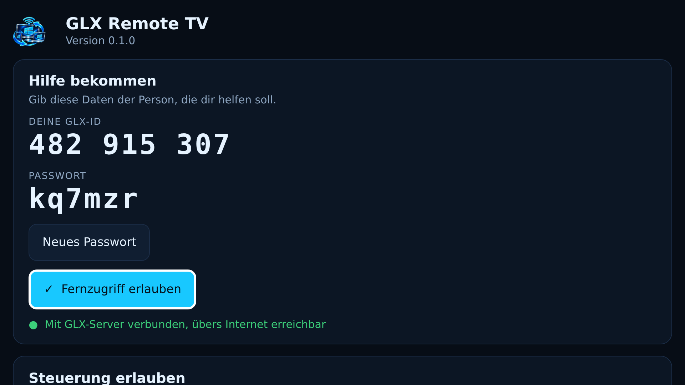
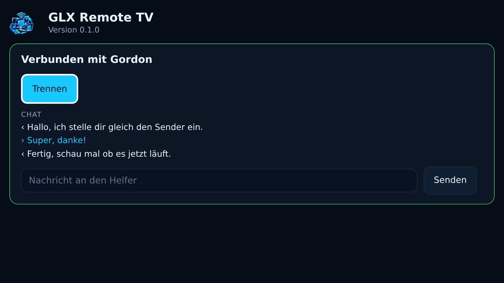
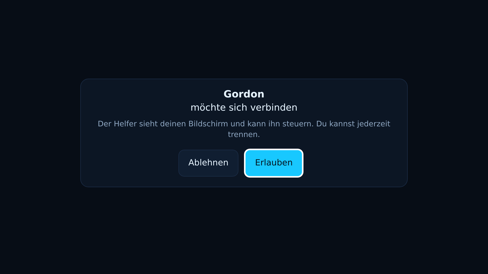

🌍 Languages: [🇺🇸 English](README.md) | [🇩🇪 Deutsch](README.de.md)

# 💠 GLX Remote Android TV

### Remote help for the TV.

*A helper on a PC sees your Android TV picture and operates it with a remote control on the screen.* ⚡

   

---

## ⬇️ Download

👉 Latest version: [Releases](../../releases/latest)  
👉 Shop and licences: [glx-tools.de](https://glx-tools.de/product/glx-remote-android-tv/)

---

## 📸 Overview & Screenshots

### 1️⃣ Main window

### 2️⃣ View 2

### 3️⃣ View 3

---

## ✨ Features

- 🚀 **Help on the TV from far away:** The helper sees the TV picture on the PC and fixes app problems, settings or channel lists without driving over.
- 🧩 **Remote like your real one:** The on-screen remote matches your device (e.g. Homatics, Philips Ambilight) with D-pad, OK, back, home, volume and playback.
- ⚙️ **Streaming app keys:** One click opens Netflix, YouTube, Prime Video or Disney+.
- 🔒 **Mouse control:** Click apps and tiles, right-click for context menus, mouse back button and wheel for scrolling.
- 📂 **Chat on the TV:** Messages from the helper appear in the top right corner over every app.
- ⚡ **Large and clear:** Full-screen app, easy to operate with the TV remote, GLX ID and password shown big side by side.
- 🎨 **Always ready:** Starts with the device if you like and stays reachable in the background.
- 🌍 **Secure:** No access without GLX ID and password, every connection confirmed on the TV, disconnect at any time.
- 🛠️ **Privacy:** Control runs through the Android accessibility service only during a session you allowed; no content is read.
- 📊 **Wide device support:** Android TV and Google TV from Android 6: Homatics, Nvidia Shield, Chromecast with Google TV, Xiaomi, Sony, Philips, TCL and more.

---

## 🧩 Requirements

- Android TV or Google TV from Android 6
- The helper needs GLX Remote Windows

---

## 🧪 Trial & License

Free of charge.

---

## 🔗 More about this product

👉 [glx-tools.de](https://glx-tools.de/product/glx-remote-android-tv/)  
For support: **info@glx-tools.de**

---

## 📄 License

Copyright © 2026 GLX Tools – Gordon Lehmann. All rights reserved.  
This is proprietary commercial software. No open-source license is granted. This repository contains release downloads and documentation only; the source code is not published.

---

Made with ❤️ by **Dreamdancer100**

